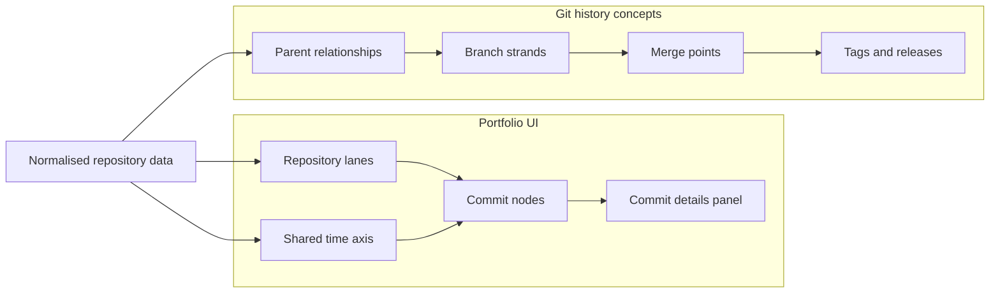
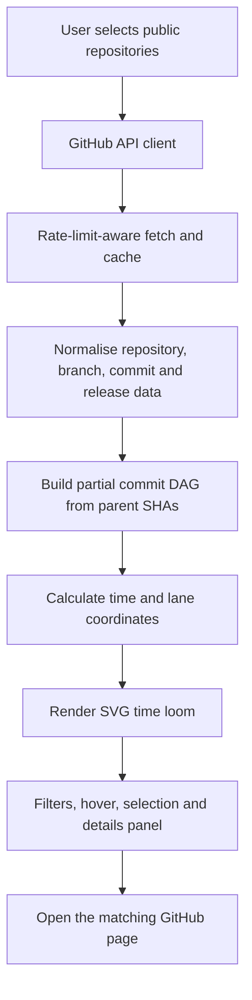

# Git Time Loom — Multi-Repository History Visualizer

> **Status:** Idea / TODO  
> **Type:** Portfolio product  
> **Priority:** Explore after the current portfolio priorities  
> **Working name:** Git Time Loom

## The idea

Build an interactive visualisation that turns the histories of multiple Git repositories into a shared **time loom**. Each repository is a thread; commits are points along that thread; branches split into strands; merges weave strands together; tags and releases mark important milestones.

The visual direction is inspired by the general idea of a science-fiction time loom, including the sense of branching timelines seen in *Loki*. Create an original interface and visual language rather than copying show artwork, logos, or exact screen designs.

**One-line pitch:** See how a collection of Git repositories evolves over time, in one interactive view.

## Why build it?

GitHub shows repository history well, but the story becomes fragmented when a project is spread across several repositories. The loom should make it easier to explore:

- Which repositories were active during a period.
- How branches split and converge.
- Where merge commits, tags, and releases occurred.
- Whether activity across related repositories overlapped.
- The message, author, date, and commit details behind any point.

The product is a **read-only history explorer**, not a replacement for Git or GitHub.

## Product experience

### Main canvas

- A horizontal time axis with zoom and pan.
- One lane per repository.
- Commit nodes positioned by timestamp.
- Parent-child links between commits when both commits are in the loaded history.
- Branch strands and merge connections where the Git data supports them.
- Distinct markers for tags and releases.
- A hover tooltip and a click-to-open details panel.
- A repository list that can be searched, reordered, hidden, or highlighted.

### Useful interactions

- Select a time range.
- Zoom from year/month to day-level activity.
- Filter by repository, author, date, and event type.
- Search commit messages.
- Click a commit to see its SHA, message, author, timestamp, parents, and GitHub URL.
- Open a commit or release on GitHub.
- Reset the canvas to fit all loaded activity.

### Visual encoding

| Git concept | Suggested visual treatment |
|---|---|
| Repository | Persistent horizontal lane / thread |
| Commit | Node on the time axis |
| Parent relationship | Connector between commit nodes |
| Branch | Diverging strand, only where branch history can be established |
| Merge commit | Convergence point with multiple parent connectors |
| Tag / release | Labelled milestone marker |
| Selected commit | Highlighted node and its connected history |
| Unloaded history | Clear boundary or loading indicator, never an implied complete history |

Keep colour meaningful and pair it with labels or shapes so the view remains usable for colour-blind users.

## Concept diagram

This is a conceptual sketch, not a claim about any real repository history.

## Technical direction

Use the existing portfolio stack first, and keep the first version small.

| Area | Initial choice | Reason |
|---|---|---|
| UI | React 19 + TypeScript | Matches the portfolio |
| Styling | Existing Tailwind CSS v4 setup | Avoid a second styling system |
| Visualisation | SVG rendered by React | Good control over nodes, strands, and accessible interactions |
| Time scale / zoom | Start with small utilities; evaluate D3 scales and zoom if needed | Add complexity only when the canvas needs it |
| Git data | GitHub REST API for public repositories | No server required for the public-only MVP |
| Tests | Existing test tooling, plus unit tests for normalisation and layout | Catch broken relationships and date placement |
| Hosting | GitHub Pages with the portfolio, or a standalone static deployment | Fits a frontend-only MVP |

Do not start with WebGL, a graph database, a backend, or AI summaries. First prove that the visualisation is useful and readable with a small sample history.

## High-level architecture

### Data model to start with

- `RepositorySummary`: owner, name, URL, default branch, description.
- `CommitNode`: repository ID, SHA, message, author, authored date, committed date, parent SHAs, GitHub URL.
- `BranchRef`: repository ID, branch name, head SHA.
- `ReleaseMarker`: repository ID, tag, title, published date, URL.
- `LoomViewport`: selected time range, zoom level, and visible repository IDs.

Keep raw API responses separate from the normalised model. Use stable IDs, parse dates explicitly, and treat missing author/date/message fields as valid API cases.

### Data-loading constraints

- Start with a curated list of **public repositories** and a configurable commit limit.
- Fetch a bounded history first, then add pagination and progressive loading.
- Cache responses for the current session and avoid re-fetching on every filter change.
- Show API errors, rate limits, partial history, and loading states in the UI.
- Parent commits may fall outside the loaded window; show those edges as truncated rather than inventing missing nodes.
- A commit can belong to more than one branch. Do not assign branch membership just because a commit appears in a branch's API response.
- Do not ship a GitHub personal access token in browser code. Private-repository support would require a carefully designed authentication/backend approach and is out of scope for the MVP.

## Implementation TODO

### Phase 0 — Decide the scope

- [ ] Confirm the name: Git Time Loom.
- [ ] Choose 3–5 public repositories for the first demo.
- [ ] Write down the first user journey: load repositories, find a busy period, select a commit, open it on GitHub.
- [ ] Sketch desktop and mobile layouts before coding.
- [ ] Define a maximum initial commit count per repository.

**Deliverable:** a narrow MVP scope and a rough wireframe.

### Phase 1 — Build the visual prototype

- [ ] Create fixture data for 3 repositories, multiple branches, parent relationships, merge commits, and releases.
- [ ] Add the shared time axis and repository lanes.
- [ ] Position commits using a deterministic time-to-x coordinate function.
- [ ] Render parent connectors and merge points.
- [ ] Add hover tooltips and a selected-commit panel.
- [ ] Check small screens and keyboard navigation.

**Deliverable:** a working loom with sample data, without API calls.

### Phase 2 — Connect GitHub

- [ ] Create a small GitHub API module, separate from React components.
- [ ] Fetch metadata, default branch, bounded commit history, branches, tags, and releases for the selected public repositories.
- [ ] Normalise API responses into the agreed model.
- [ ] Handle pagination, HTTP errors, missing fields, and rate-limit responses.
- [ ] Cache fetched data and expose partial-history status.
- [ ] Keep repository selection configurable rather than hard-coding data inside visual components.

**Deliverable:** the loom renders real public repository histories.

### Phase 3 — Make the loom explorable

- [ ] Add horizontal pan and zoom.
- [ ] Add date-range and repository filters.
- [ ] Add author and event-type filters.
- [ ] Add commit-message search.
- [ ] Add clear reset / fit-all controls.
- [ ] Add direct links to commit, tag, and release pages on GitHub.
- [ ] Preserve smooth interactions for larger histories; virtualise or limit off-screen nodes if required.

**Deliverable:** a useful history exploration tool, not just a static graph.

### Phase 4 — Quality and portfolio integration

- [ ] Unit-test date normalisation, parent linking, merge detection, and coordinate calculation.
- [ ] Add component tests for filtering and selecting commits.
- [ ] Add loading, empty, error, partial-history, and rate-limit states.
- [ ] Audit keyboard support, focus states, labels, contrast, and reduced-motion behaviour.
- [ ] Run the project's lint, format, and production build checks.
- [ ] Add screenshots, a short demo GIF/video, setup steps, limitations, and architecture notes.
- [ ] Add the finished project to the portfolio project's data and confirm the links work in the GitHub Pages base path.

**Deliverable:** a documented, deployable portfolio project.

## MVP acceptance criteria

The MVP is ready when:

- A user can load at least three configured public repositories.
- Each repository has its own lane on one shared time axis.
- Loaded commit nodes are placed according to their timestamps.
- Parent connections and merge commits are rendered only when supported by the loaded data.
- Selecting a node reveals useful commit metadata and opens the corresponding GitHub page.
- Users can filter by repository and date range.
- API failure or truncated history is clearly communicated.
- No private token or secret is embedded in the client bundle.
- The application builds and works from the portfolio's deployed base path.

## Not in the first version

- Private repositories and sign-in.
- Writing to repositories, creating branches, or triggering Git operations.
- AI-generated summaries or inferred causal relationships between repositories.
- Full GitHub issue / pull-request analytics.
- Real-time event streaming.
- 3D rendering or WebGL.

These can be reconsidered only after the 2D timeline proves useful.

## Key risks and decisions

| Risk | Mitigation |
|---|---|
| GitHub API rate limits | Bounded requests, session cache, visible retry guidance |
| Too many nodes make the canvas unreadable | Commit limits, date filters, zoom levels, progressive loading |
| Branch membership is ambiguous | Use parent SHAs for graph edges; present branch refs as refs, not definitive ownership |
| Incomplete parent history | Mark the edge/history as truncated |
| Colour alone carries meaning | Combine colour with labels, shapes, and accessible focus states |
| Mobile layout becomes crowded | Provide a compact lane list and horizontally scrollable timeline |

## Suggested first working session

1. Pick three public repositories with visibly different histories.
2. Create a fixture JSON file with 20–50 commits and realistic parent links.
3. Build just the time axis, repository lanes, and commit nodes.
4. Test whether someone can understand the timeline without an explanation.
5. Only then connect the GitHub API.

**First milestone:** a convincing SVG prototype with sample data. Do not begin with API integration; the visual model is the main product risk.
